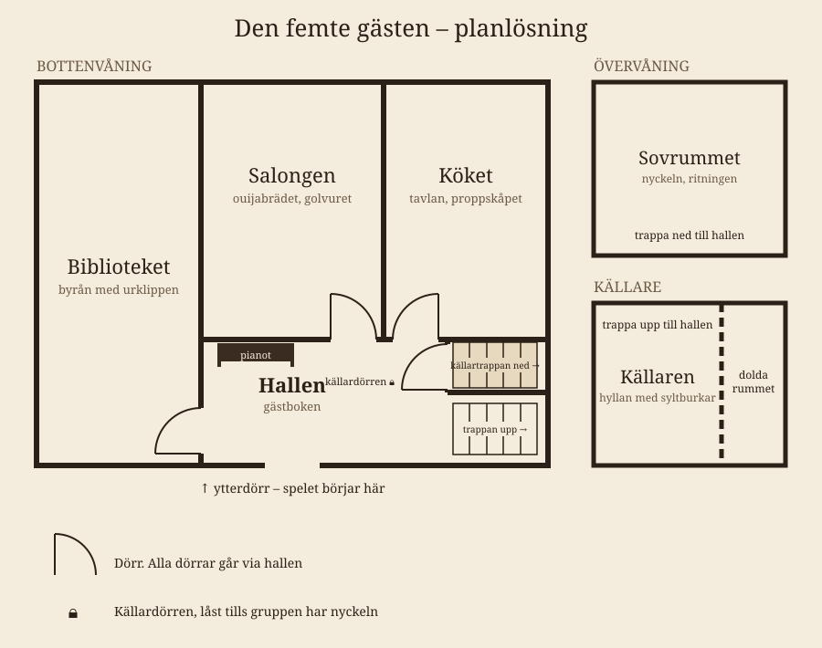

# Escape room för mobiler – koncept och upplägg

Nov 16, 2026 · @Jonas Olsson

## Om dokumentet

Dokumentet beskriver hur ett samarbetsspel i escape room-stil kan byggas för mobiler: principer, uppgiftstyper, hur ett uppdrag är uppbyggt, skalning och teknik. Det är ett första förslag att arbeta vidare från och är tänkt som underlag i ett Claude Code-projekt.

Spelmotorn och uppdragen hålls isär. Motorn och uppgiftstyperna byggs en gång, och varje uppdrag är innehåll som kombinerar dem med en egen berättelse. Det första uppdraget, spökhuset Den femte gästen, beskrivs sist i dokumentet.

Inget är provspelat ännu. Tider, svårighetsgrad och vad mobilerna klarar är uppskattningar som behöver prövas.

Begreppen som används här och i koden förklaras i [ordlistan](ordlista.md).

## Spelidén i korthet

Spelet är ett partyspel: tre till tio personer som umgås i samma hem löser ett uppdrag tillsammans på ungefär 60 minuter, var och en med sin mobil.

- **Ingen installation.** Spelet är en webbsida. Spelarna går med genom att skanna en kod.
- **Olika information.** Spelarna ser olika saker på sina skärmar, och ingen kan lösa en uppgift ensam.
- **Växlande uppgifter.** Lugna logiska gåtor varvas med moment i realtid där alla använder mobilerna samtidigt.
- **Rörelse i huset.** Utskrivna QR-koder i olika rum gör att gruppen splittras och måste samarbeta på avstånd. Spelet kan stänga in eller låsa ute en spelare när berättelsen kräver det.
- **En berättelse som bär.** Varje uppdrag har en historia med en vändning, och spelarna avslöjar den själva genom det de hittar.
- **Flera uppdrag.** Samma motor ska kunna bära ett spökhus, en mordgåta, en zombieapokalyps eller en skattjakt.

## Vad som gör spelet roligt

Elva principer styr alla uppgifter och uppdrag. De första sex handlar om upplevelsen, de sista fem om att spelet ska fungera en vanlig kväll hemma hos någon.

1. **Alla behövs hela tiden.** Varje uppgift har roller som är beroende av varandra. Den som ser kan inte agera, och den som agerar ser inte. Att läsa upp en tabell för någon annan räknas inte som samarbete.
2. **Mobilen är ett föremål, inte ett papper.** Den lutas, hålls mot örat, läggs bredvid andra mobiler, skannar koder och låter. Spelet reagerar direkt på det spelaren gör.
3. **Variation i vad man gör.** Två uppgifter i rad får aldrig vara av samma typ. Tempot växlar mellan lugnt och stressigt, och gruppen mellan samlad och splittrad.
4. **Berättelsen upptäcks.** En vändning ska dyka upp på en spelares skärm och berättas av den spelaren, inte förklaras i en sluttext.
5. **Misslyckanden kostar men stoppar inte.** Ett fel eller en överskriden tid ger en följd i berättelsen, som ett förlorat verktyg eller ett sämre slut. Ingen grupp ska fastna.
6. **Skratt och kaos är välkomna.** Det är ett partyspel. Att alla ropar i mun på varandra är ett gott tecken, och en uppgift som slutar i fiasko ska vara rolig att berätta om efteråt.
7. **Låg tröskel.** En ovan spelare ska förstå vad hon ska göra inom en minut. Reglerna lärs ut av den första uppgiften, inte av en instruktion.
8. **Korta texter och få namn.** Högst några rader per skärm. Människor, rum och föremål har vanliga namn, inga tekniska beteckningar.
9. **Minimala förberedelser.** Spelledaren ska kunna starta på ett par minuter. Att skriva ut och tejpa upp några QR-koder är gränsen för grundspelet.
10. **Reserv för allt.** Varje moment som kräver en utskrift, en sensor eller en fysisk handling har ett alternativ på skärmen som gör uppgiften lösbar.
11. **Oberoende av bostaden.** Ingen uppgift får kräva en viss planlösning, möblering eller belysning. Spelet ska fungera i en etta och i en villa.

### Förberedelsenivåer

Varje uppgift och uppdrag märks med en nivå, så att spelledaren vet vad som krävs i förväg.

| Nivå | Vad spelledaren gör | Tid | Status |
| --- | --- | --- | --- |
| 1 | Skriver ut ett ark med QR-koder eller ett dokument och lägger ut det | Ett par minuter | Grundspelet |
| 2 | Placerar ut flera dokument, ställer in ett hänglås, lägger ett föremål i en låda | Några minuter | Senare |
| 3 | Klipper, viker, monterar eller bygger rekvisita | Längre | Bara särskilda uppdrag |

## Uppgiftstyper

Tolv uppgiftstyper utgör spelets byggstenar. Varje typ byggs en gång i motorn och fylls sedan med olika innehåll i olika uppdrag.

| Typ | Vad spelarna gör | Tempo | Mobilen används för |
| --- | --- | --- | --- |
| Lotsen | En ser vägen men kan inte styra, en annan styr utan att se | Realtid | Lutning, röst |
| Samtidigt | Alla håller in, trycker eller släpper i rätt ögonblick eller rätt ordning | Realtid | Tryck på skärmen |
| Delat vittnesmål | Var och en har en bit av en logisk gåta och gruppen pusslar ihop dem | Lugnt | Läsa och visa |
| Splittrade rum | Spelarna går till olika rum, skannar en kod och ropar till varandra vad de ser | Lugnt | Kamera, QR-kod |
| Instängd | En spelare isoleras med en egen vy och de andra lotsar ut henne | Realtid | Rundbild, ficklampa |
| Tystad | En spelare får hemlig information men får bara svara ja eller nej, knacka eller mima | Lugnt | Hemlig skärm |
| Ett öra | Ett ljud hörs bara i en mobil, och den spelaren beskriver eller återger det | Blandat | Högtalare mot örat |
| Orkestern | Varje mobil har några tangenter eller toner och gruppen spelar en följd tillsammans | Realtid | Ljud, tryck |
| Skärmar ihop | Mobilerna läggs bredvid varandra och bildar en karta eller bild | Lugnt | Skärmen som pusselbit |
| Mänskliga pusselbitar | Spelarna ställer sig i ordning eller formation efter vad deras mobiler visar | Lugnt | Hemligt värde |
| Sökaren | Spelaren ser sig omkring i ett rum genom mobilen och letar efter något | Lugnt | Rundbild, vridning |
| Dokumentet | Ett utskrivet brev eller urklipp gömmer ett budskap, och spelarna har olika regler för hur det ska läsas | Lugnt | Egen läsnyckel |

Typerna kan kombineras. Instängd och Lotsen blir tillsammans en flykt ur en källare, och Splittrade rum och Delat vittnesmål blir en gåta där ledtrådarna finns i olika rum.

### Vad varje uppgift ska ange

- Typ, tempo och uppskattad tid.
- Roller, och hur de fördelas vid tre till tio spelare.
- Vad varje roll ser och kan göra.
- Hur uppgiften klaras, och vad som händer vid misslyckande.
- Vilken bit av berättelsen den avslöjar, och på vems skärm.
- Tre ledtrådar i stigande tydlighet.
- Förberedelsenivå, material och reserv.
- Vilka mobilfunktioner den kräver.

## Hur ett uppdrag är uppbyggt

Ett uppdrag är ungefär 60 minuter långt och består av åtta till tio uppgifter på fyra till åtta minuter, fördelade på tre akter.

| Akt | Tid | Syfte | Uppgifter |
| --- | --- | --- | --- |
| 1 – Kroken | Cirka 15 min | Lära ut spelet och väcka nyfikenhet | Enkla, gruppen samlad |
| 2 – Upptäckterna | Cirka 30 min | Sprida ut gruppen, avslöja bakgrunden, leverera vändningen | Blandade, flera i olika rum |
| 3 – Finalen | Cirka 15 min | Press, ett val och ett slut | Realtid, alla samtidigt |

**Berättelsen.** Varje uppdrag har en sann bakgrund som bara systemet känner till. Varje uppgift avslöjar en bit av den. Minst en vändning upptäcks av en enskild spelare på hennes egen skärm.

**Rytmen.** En lugn uppgift följs av en stressig, och en uppgift där gruppen sitter samlad följs av en där den sprids ut.

**Tiden.** Gruppen har en gemensam nedräkning på 45, 60 eller 75 minuter. Den visas i mobilerna, där varje spelare kan växla till en nedräkningsvy. Spelet kräver ingen gemensam skärm. När tiden tar slut fortsätter spelet, men slutet blir sämre.

**Ledtrådarna.** Varje uppgift har tre ledtrådar som hela gruppen får samtidigt. De levereras inom berättelsen, till exempel som en viskning från spöket. Spelledaren kan också hoppa över en uppgift som har låst sig.

**Följderna.** Ett misslyckande kostar tid eller en resurs som märks senare. Ett uppdrag har minst två slut, så att gruppens val och prestation syns.

**Återkopplingen.** Spelet svarar direkt på det spelarna gör. Gissningar förhindras genom att svaret är en handling eller ett samspel, inte genom att dölja vad som blev fel.

## Tre till tio spelare

Den femte gästen går också att spela med två, så att den kan provas med två mobiler (Jonas 2026-11-18).

Uppgifterna byggs kring roller i stället för personer, så att samma uppgift fungerar oavsett hur många som spelar.

| Antal | Upplägg |
| --- | --- |
| 2 | Går att spela, framför allt för att prova. I källaren lotsar en ensam den instängda med de viktigaste bitarna (Jonas 2026-11-18). |
| 3 | En spelare per roll. Minsta antal för att någon ska kunna stängas in medan två hjälper till utifrån. |
| 4–6 | En eller två spelare per roll. Par som delar roll får olika bitar av den. |
| 7–10 | Två eller tre per roll. I de lugna uppgifterna delas gruppen i två lag som behöver varandras fynd. |

- **Par får aldrig samma skärm.** Om två delar roll ser den ena och den andra hör, eller så har de varsin halva. Annars blir en av dem åskådare.
- **Rollerna roterar.** Motorn håller reda på vem som har haft en framträdande roll, så att alla får vara den instängda eller den som styr någon gång. Den som har väntat längst får nästa. Är det lika, som i början när ingen har haft någon, lottas det mellan dem (Jonas 2026-11-18). Allt annat som delas ut, som roller, urklipp och pianots tangenter, lottas också i stället för att gå på ordningen man gick med i (Jonas 2026-11-18).
- **Realtidsuppgifter skalar lättast.** Fler spelare betyder fler händer som ska synkas. De logiska uppgifterna är svårast att skala och behöver lagdelning vid stora grupper.
- **Folk kommer och går.** Det är en fest. En spelare ska kunna tappa anslutningen, ladda om sidan eller gå och hämta dricka utan att spelet låser sig. Rollen ligger kvar vid omladdning och kan tas över av någon annan.

## Spelledaren, rummen och QR-koderna

Spelledaren väljer uppdrag och speltid, skriver ut ett ark med QR-koder, sätter upp dem och startar. Resten sköter spelet.

**Under spelet** kan spelledaren pausa, ge nästa ledtråd och hoppa över en uppgift. Allt det ligger i hennes meny, en hamburgare som alltid finns i nedre högra hörnet (Jonas 2026-11-18). Där finns Pausa spelet och Hoppa över uppgiften i en uppgift. I urklippen, som väntar på både läsningen och Rummen minns, räknar Hoppa över uppgiften alla som lästa och hoppar över Rummen minns med ett tryck (Jonas 2026-11-18). En scen har ingen knapp i menyn. Den går vidare när alla har tryckt Ok eller Klar (Jonas 2026-11-18). Ge ledtråd och Visa facit för mig finns i menyn var spelledaren än är, så länge gruppen har en olöst uppgift. Är uppgiften redan klarad syns de inte. Det finns bara en knapp Ge ledtråd, och servern väljer vilken ledtråd som kommer, så att spelledaren inte behöver veta vad gruppen väntar på. Ledtrådarna numreras genom hela steget, Ledtråd 1, Ledtråd 2 och så vidare, och rubriken säger inte vad de gäller. Det får texten säga när det behövs. Har ingen hittat saken som uppgiften börjar vid är första ledtråden att den finns i huset, till exempel Det finns ett ouijabräde någonstans i huset. Den texten står på saken i uppdragsfilen (Jonas 2026-11-18). Pausa spelet stoppar allt, inte bara nedräkningen. En ruta täcker alla mobiler så att ingen kan spela, inte heller spelledaren, men hennes meny ligger ovanpå så att hon kan fortsätta. Servern tar inte emot något från spelarna under pausen, och det som går på tid, som minnet i Rummen minns och skenet på brädet, står still (Jonas 2026-11-18). Sist i menyn ligger Avsluta spelet, som avslutar spelet för alla, var gruppen än är (Jonas 2026-11-18). Det går inte att ångra, så menyn frågar först. Sedan visar alla mobiler att spelledaren har avslutat spelet, med knappen Till startsidan, och mobilerna glömmer spelet som när uppdraget tar slut av sig självt. Den som väntar på att få vara med släpps och ser samma sak. Ingen ser vilka som är klara, inte heller spelledaren, och ingen rad säger att mobilen väntar på de andra. Efter Ok i en berättartext är spelaren tillbaka i huset och kan leta medan de andra läser, och nästa steg märks av sig självt (Jonas 2026-11-18). Spelledaren spelar med som standard och kan välja att stå utanför. Då blir hennes mobil en ren administrationsvy med samma funktioner, och hon får ingen roll i uppgifterna. Facit visas bara om hon ber om det.

**Varje uppdrag har rum.** Spelarna går mellan rum, vare sig det är ett hus, en ubåt eller en rymdraket. Det man hittar ligger i sitt rum, och vill man se det igen går man tillbaka dit. Det finns ingen lista över det man har hittat (Jonas 2026-11-18). Provhuset, som bara används för att prova motorn, har inga rum än.

**Fyra hörn.** Varje skärm har samma fyra hörn: uppdraget uppe till vänster, tiden uppe till höger, en statusrad nere till vänster och spelledarens meny nere till höger. Statusraden är en kort rad text som står kvar och beskriver läget, som Gå runt i huset och leta eller vem skenet väntar på. I fullskärm står Tillbaka i uppdragets hörn. Hörnen följer innehållets kanter, i mobil som i dator, och knappar står ovanför den nedre raden (Jonas 2026-11-18).

**Allt man går in på visas i fullskärm.** Det gäller i alla uppdrag. Ett tryck på en sak, som ett bräde, ett instrument, ett papper eller en bok, öppnar en vy som fyller skärmen, utan rubrik och text. Överst står Tillbaka och klockan, och underst en eventuell huvudhandling nära tummen (Jonas 2026-11-18). Saken slutar alltid en bit ovanför underkanten. Där finns plats för en kort text när det behövs, som vem skenet väntar på vid ouijabrädet, och i hörnet ligger spelledarens meny som i alla vyer. Spelarna har samma luft, fast de inte har menyn (Jonas 2026-11-18). Bakgrunden går kant i kant, men själva innehållet, som saken, brädet eller en berättartext, har en största bredd och höjd. Innehållet börjar överst, direkt under Tillbaka och tiden, som i textvyn, och centreras inte i höjdled (Jonas 2026-11-18). I mobilen får det ta telefonens hela bredd. I iPad och dator är ytan lite större, men dras inte ut över hela skärmen, så att saken ser likadan ut överallt (Jonas 2026-11-18).

- **Alla har Tillbaka.** Knappen uppe till vänster heter Tillbaka och tar spelaren ut ur vyn till det hon kom från. Klockan står alltid uppe till höger. Tillbaka, klockan och spelledarens meny står i innehållets kanter, inte i skärmens, så att de hamnar intill saken också i iPad och dator (Jonas 2026-11-18). Spelarna har ingen meny (Jonas 2026-11-18).
- **Spelledarens meny ligger i hörnet.** Spelledaren har också Tillbaka överst, och hennes meny är hamburgaren i nedre högra hörnet. Hamburgaren ligger ensam i den understa raden och aldrig bredvid en knapp, i mobil som i dator. Spelledarens knappar står en rad högre och får hela bredden, medan spelarnas knappar ligger kvar längst ner (Jonas 2026-11-18). En rad text utan knapp, som Gå runt i huset och leta eller vem skenet väntar på, står bredvid hamburgaren (Jonas 2026-11-18). Stegets text står inte i menyn, vid någon sak. Vid brädet upprepade den seansens första ledtråd, och det som behövs ska stå i ledtrådarna (Jonas 2026-11-18).
- **Ingen text i vyn, ledtrådar i en inforuta.** Vyn visar bara saken, utan stegets text, som pianot, golvuret och ouijabrädet. Texten finns inte heller i spelledarens meny. Hur man gör vid brädet är seansens första ledtråd (Jonas 2026-11-18). Ger spelledaren en ledtråd visas den i en ruta längst ner hos alla en stund. Rutan följer innehållets kanter som spelledarens meny, så att den inte går i full skärmbredd i iPad och dator. Pausrutan och sluttexten har också sin text inom innehållets yta (Jonas 2026-11-18). Rutan går att trycka bort. Ledtrådarna står inte kvar i någon lista, det räcker att de syns en stund i rutan (Jonas 2026-11-18).
- **Berättartexter visas i fullskärm.** En berättartext fyller skärmen, och spelaren trycker Ok när hon har läst. Alla berättartexter visas på samma sätt, med text och knappen Ok, också scenerna mellan uppgifterna (Jonas 2026-11-18). Texten dyker upp av sig själv när uppgiften börjar, och visas bara en gång. Den som får pianots melodi får till exempel direkt efter ouijabrädet texten att hon hör en melodi i huvudet (Jonas 2026-11-18). Det som hörs från ett annat rum när något kallar på gruppen, som planchetten eller pianots ton, är också en berättartext (Jonas 2026-11-18).
- **Papper ligger i en hög.** Flera papper, som urklipp eller sidorna i en bok, ligger ovanpå varandra med kanterna synliga, och spelaren bläddrar genom att svajpa i sidled eller med pilar (Jonas 2026-11-18).
- **Undantag.** Den som är instängd i källaren behåller menyn tills vidare, eftersom hon inte kan gå tillbaka därifrån.

**Platskort i stället för uppdragskoder.** Arket innehåller sex platskort, A till F, som återanvänds i alla uppdrag. Uppdraget bestämmer vad varje plats är för kvällen: A är källaren i spökhuset och karantänen i zombieuppdraget. Arket skrivs därmed ut en enda gång.

**Koden säger ingenting.** En QR-kod innehåller bara ett id. Servern avgör vad som händer när någon skannar, beroende på vem det är och var i uppdraget gruppen befinner sig.

**Placeringen.** Korten sätts upp i olika rum, eller i olika hörn om bostaden är liten. Det enda kravet är att spelarna vid olika kort inte ser varandras skärmar.

**Instängd och utelåst.** Ingen dörr låses på riktigt. Den som är instängd får en regel på sin skärm, till exempel att stanna vid kortet tills de andra har släppt ut henne. Den som är utelåst får en mörk skärm eller en egen uppgift.

**Reserven.** Om utskrift saknas eller kameran inte fungerar väljer spelaren plats i en lista på skärmen.

**Spel utan platskort.** Spelet skannar inga platskort just nu. Rutan Vi har satt upp platskorten i väntrummet och skanningen i spelet är borttagna, eftersom rummen finns i mobilen (Jonas 2026-11-18). Spelarna väljer plats i listan eller går dit i huset, och inget ark behöver skrivas ut.

## Teknik

Spelet är en webbapp som körs i mobilens webbläsare, med en server som håller spelets tillstånd och skickar rätt vy till rätt spelare i realtid.

- **Servern äger sanningen.** Spelstatus, rollfördelning och facit ligger på servern. En mobil får bara det material dess spelare ska se.
- **Kanalerna kräver behörighet.** Den publika nyckeln till Supabase ligger öppet i webbsidan. Därför får en mobil bara lyssna och skicka i sitt eget spel, och bara det som dess spelare ska se.
- **Servern avgör samtidighet.** Synkade moment mäts av servern och får inte bygga på att mobilernas klockor går lika.
- **Uppdrag är data.** Ett uppdrag beskrivs i en fil med uppgifter, roller, texter, bilder och ljud. Motorn tolkar filen, så att ett nytt uppdrag inte kräver ny kod så länge det använder befintliga uppgiftstyper.
- **En modul per mobilfunktion.** Kamera, rörelse, ljud och övrigt kapslas in var för sig. Modulen kontrollerar om funktionen finns, ber om tillstånd och växlar till reserven vid behov.
- **React och Vite, som i Maffia.** Webbsidan byggs med React och Vite och har samma verktyg och upplägg som Maffia, men skrivs i TypeScript (Jonas 2026-11-16).
- **Inga andra bibliotek före behov.** Kandidater att utvärdera när en uppgift kräver dem är Tone.js och Howler.js för ljud och dnd-kit för dra och släpp. QR-koder läses med jsQR där webbläsaren saknar egen läsare.
- **En teknisk testsida.** Varje funktion ska kunna provas för sig på iPhone Safari och Android Chrome, utan att ett helt uppdrag startas.

### Drift

Projektet börjar från noll. GitHub Pages kan bara leverera färdiga filer och har ingen server, så det räcker inte ensamt. Spelet behöver tre saker därutöver: en databas för spelsessioner, en realtidskanal mellan mobilerna och serverkod som kontrollerar svar utan att facit når mobilen.

Webbsidan ligger kvar på GitHub Pages, och Supabase står för databas, realtid och serverkod. Kraven ovan stäms av mot Supabases gratisnivå när projektet sätts upp.

### Mobilens funktioner

Begränsningarna nedan är min bild av läget och ska bekräftas på riktiga mobiler innan en uppgift byggs på dem.

| Funktion | Används till | Att tänka på | Reserv |
| --- | --- | --- | --- |
| Rörelse och lutning | Se sig omkring, styra | iPhone kräver att spelaren godkänner efter ett tryck | Dra med fingret |
| Kamera | Skanna platskort | Kräver tillstånd och säker anslutning | Välja plats i en lista |
| Ljud | Röster, larm, toner, ljud i en enda mobil | Startar först efter ett tryck; ljudlöst läge och blåtandshörlurar ställer till det | Text eller bild med samma innehåll |
| Vibration | Hemlig signal till en spelare | Saknas i regel i iPhones webbläsare | Diskret blinkning på skärmen |
| Kompass | Riktningar | Opålitlig inomhus | Riktning relativt spelaren, inte väderstreck |
| Mikrofon | Knackningar, ljudnivå | Osäker tolkning, kräver tillstånd | Knacka på skärmen |
| Vaken skärm | Skärmen får inte slockna mitt i en uppgift | Stödet varierar mellan webbläsare | Påminnelse att röra skärmen |

Tillstånden för rörelse, kamera och ljud bör samlas in tidigt och inom berättelsen, så att ingen systemruta dyker upp mitt i en spännande scen.

### Rundbilder

Uppgiftstyperna Instängd och Sökaren behöver en rundbild per rum. Bilderna är den största produktionskostnaden i ett uppdrag. Mörker och ficklampa minskar den, eftersom spelaren aldrig ser hela bilden på en gång.

Rundbilderna tas fram som illustrationer med Googles Gemini-API och bildmodellen Nano Banana 2.1. Modellerna beskrivs i [Geminis dokumentation](https://ai.google.dev/gemini-api/docs/image-generation.md.txt). API:et tar inte formatet 2:1, så bilden tas fram i 16:9 och trycks ihop efteråt.

Det är prövat på testsidan med tre källarbilder, och rundbilderna håller. Provet beskrivs i `docs/rundbilder-prov.md`.

- **Skarven** där bildens kanter möts syns inte i någon av bilderna.
- **Golv och tak** förvrängs nära rakt upp och rakt ner, och där kan Gemini också måla fel. Upp till ungefär 30 grader från horisonten ser rummet rätt ut. Uppgifterna ska därför inte lägga något viktigt i taket eller på golvet under spelaren, och mörker och ficklampa får dölja resten.
- **Samma stil i flera rum** är inte prövat med olika sorters rum. De tre källarna fick samma stil av samma stilbeskrivning.
- **Rummets storlek** styrs av hur bilden beskrivs för Gemini, inte av visaren. I ett stort rum blir sakerna små och suddiga när spelaren zoomar in.

Spelaren ser sig omkring genom att vrida sig med mobilen, och fingret är reserven. Hon kan zooma med två fingrar och visa bilden över hela skärmen. En vuxen blev lite yr av att se sig omkring, barnen blev det inte. Efter prov på riktig mobil gäller därför två saker: rummet hålls vågrätt när mobilen lutas i sidled, och visaren använder det mjuka perspektivet, som inte drar ut bildens kanter.

Provbilderna är inte de slutliga. Bilderna till Den femte gästen tas fram på nytt, och de ska vara läskigare än provbilderna, som togs fram för tioåringar.

Reserven är en bred illustration som spelaren bara kan panorera i sidled. Den finns i visaren och tar över av sig själv om mobilen inte klarar rundvisaren.

### Saker i rundbilden

En rundbild kan ha saker som spelaren undersöker, till exempel en etikett på en flaska, en lapp eller en inristning i väggen. Det ger Sökaren och Instängd något att hitta.

- **Det man hittar kräver någon annan.** Saken ger en bit som en annan spelare behöver, inte en ledtråd som spelaren löser ensam.
- **Korta texter.** En etikett eller en rad på en lapp. Längre texter hör hemma i uppgiftstypen Dokumentet.
- **Generös träffyta.** Saken tänds när den hamnar nära bildens mitt eller i ficklampans sken, och ett tryck var som helst på skärmen öppnar den då. Spelaren ska inte behöva träffa en liten sak med tummen medan hon vrider mobilen.
- **Saker är data.** En sak beskrivs i uppdragsfilen med en riktning och en storlek. Servern skickar innehållet först när spelaren öppnar det.

Det byggs i rundvisaren när rundbilderna har visat sig hålla.

### Röster och viskningar

Röster och viskningar genereras i förväg och sparas som ljudfiler i uppdraget. Inget tal skapas under spelets gång, så spelet behöver ingen talmodell i drift.

Två tjänster är kandidater. [Geminis talfunktion](https://ai.google.dev/gemini-api/docs/speech-generation) ligger i samma API som bilderna och styrs med vanlig text, till exempel en begäran om en kuslig viskning. Svenska finns med i [språklistan](https://docs.cloud.google.com/text-to-speech/docs/gemini-tts) som förhandsversion. [ElevenLabs v3](https://elevenlabs.io/docs/help-center/product/core-capabilities/text-to-speech/what-is-eleven-v3-alpha) styrs med taggar som \[whispers\] och har svenska bland sina språk.

Hur bra en svensk viskning faktiskt låter är oprövat. Reserven är att spela in rösterna själv.

## Första uppdraget: Den femte gästen

Den femte gästen är ett spökhusuppdrag på cirka 60 minuter med nio uppgifter. Rummen finns i mobilen, så inget behöver förberedas och inga platskort sätts upp (Jonas 2026-11-17).

**Tonen.** Uppdraget ska vara läskigt och samtidigt roligt, från 16 år. Stämningen byggs med mörker, viskningar i en enda mobil och skrämselmoment, som en skärm som plötsligt slocknar. Inget blod och inget våld. Åldern höjdes från ungefär tio år i november 2026, för att uppdraget ska få vara läskigare.

### Vad spelarna får veta

Från början vet spelarna bara att de är ett gäng vänner som är nyfikna på det övernaturliga och har tagit sig in i ett hus där det sägs spöka, för att se om de döda vill tala med dem (Jonas 2026-11-17). Ordet seans förklaras inte, eftersom alla inte vet vad det betyder. Inledningen säger i stället att det finns ett ouijabräde i huset och vad det är. Mobilerna är instrumenten. Någon svarar på brädet och bokstaverar HJÄLP MIG. Sedan får gruppen leta själv (Jonas 2026-11-17). Den som svarar säger inte vem den är, och ingen text avslöjar att den femte var en kvinna innan gruppen har svarat (Jonas 2026-11-18).

Resten tar de reda på själva. Av urklippen i byrån får de veta att en seans hölls i huset en kväll 1962, att fem unga gäster kom men bara fyra gick därifrån, och att den femte aldrig sågs mer. Att den femte hette Vera, och att det är hon som svarar, förstår de när de har lagt ihop vem som var vem.

### Sann bakgrund, bara för systemet

Huset behåller alltid en gäst. Den som är fast kan bara lämna det om någon annan tar platsen. 1962 lockade husets dåvarande fånge ner Vera i källaren. De fyra andra gästerna förstod vad som höll på att hända, låste källardörren och flydde.

Vera ljuger inte för spelarna, men hon berättar inte allt. Hennes hjälp leder steg för steg en av dem ner i källaren.

### Vändningen

Den instängda spelaren hittar namn inristade i källarväggen, vart och ett överstruket och följt av nästa. Det sista är Vera. Under det håller spelarens eget namn på att ristas in. Bara hon ser det, och hon måste berätta det för de andra genom dörren.

### Platser

Husets rum är salongen, hallen, köket, sovrummet och källaren. Huset har ingen övervåning, och sovrummet ligger där biblioteket låg (Jonas 2026-11-20). De finns i mobilen, och spelarna går mellan dem på skärmen utan att lämna bordet (Jonas 2026-11-17). Spelet säger vart var och en ska, men alla kan gå vart de vill.

Två gånger går en spelare iväg på riktigt, till ett annat rum i bostaden med stängd dörr (Jonas 2026-11-17):

- **Vera minns.** Vera tar över spelarens mobil. Skärmen blir svart och skriver "Gå ut. Stäng dörren efter dig." Spelaren trycker Klar först när dörren är stängd, och knackar sedan Veras svar på dörren.
- **Källaren.** Den instängda går till ett annat rum och stänger dörren, och de andra lotsar henne genom dörren.

Det är de enda tillfällena då gruppen splittras på riktigt, och de blir starkare av det.

### Planlösning

Huset är en rektangel med en våning och källare. Övervåningen är borttagen (Jonas 2026-11-20). Ytterdörren leder in i hallen, mitt på husets framsida. Rakt fram ligger salongen, till vänster sovrummet och till höger köket. Sovrummet var tidigare ett bibliotek, och byrån med tidningsurklippen står kvar där (Jonas 2026-11-20). Källaren ligger under huset, med det dolda rummet bakom.

- **Hallen.** Dörren till salongen sitter längst till höger i hallens bortre vägg, med pianot till vänster om den. Dörren till köket sitter strax till höger om salongsdörren. Dörren till sovrummet sitter långt ner på vänstra väggen. I högra hörnet vid ytterväggen ligger källartrappan på tvären, bakom den låsta källardörren (Jonas 2026-11-18). Trappan upp till övervåningen är borttagen (Jonas 2026-11-20).
- **Bara via hallen.** Det finns inga dörrar mellan de andra rummen, så alla rum nås från hallen (Jonas 2026-11-18).
- **Dörrarna i rundbilderna.** I rundbilderna är alla rum kvadratiska, så att varje vägg blir en fjärdedel av varvet (Jonas 2026-11-18). Dörrarna ska sitta på rätt ställe i rummen enligt planlösningen, och i beskrivningen till Gemini anges varje dörr med vägg och läge, till exempel vänstra väggen nära hörnet mot ytterväggen (Jonas 2026-11-18). Gemini följer inte alltid beskrivningen exakt, så de tryckbara dörrarna placeras där de hamnade i bilden, och en bild med en dörr på fel vägg tas fram på nytt.

### Nu och 1962

Varje plats finns i två tider: som den är nu och som den var kvällen 1962 (Jonas 2026-11-17).

- **Nu.** När en spelare går till en plats ser hon platsen som den är i kväll, med det som gruppen har hittat där. Det som en gång har hittats ligger kvar och går att se igen, till exempel urklippen i sovrummet (se Textvyn och rumsvyn nedan). Gruppen går fortfarande igenom uppgifterna i ordning, men behöver inte minnas allt.
- **Klockan.** Alla klockor i huset stannade kvart över nio, när ljuset slocknade 1962. Det finns en enda klocka att vrida, golvuret i salongen (Jonas 2026-11-17). Den som står vid det drar visarna med fingret. Att vrida mobilen som en ratt prövades men togs bort (Jonas 2026-11-18). Visarna hakar i var femte minut, så att det går att träffa rätt. Står de på 21.15 minns hela huset, för alla spelare samtidigt, och alla platser visas som de var då. Vrids de till vilken annan tid som helst är huset tillbaka i nu (Jonas 2026-11-17). Golvuret står i salongens lista när någon har hittat det, och visarna går att vrida när som helst, också innan gruppen har läst urklippen och efter att uppgiften är klar. Står de på 21.15 innan berättelsen har kommit dit minns huset ändå, och uppgiften räknas (Jonas 2026-11-18). Efter att uppgiften är klar flyttas bara visarna.
- **Minnet syns.** Minnesbilden är sepiatonad, kornig och flimrar lite, med en rad överst som säger platsen och tiden. Alla spelare ser att huset minns, var de än är.
- **Ett rum var i minnet.** När huset minns väljer varje spelare vilket rum hon ska vara i, bland dem som finns kvar, och hon stannar där tills minnet bleknar (Jonas 2026-11-17). Nästa gång väljer alla på nytt, så att spelarna kan byta rum med varandra. Är spelarna fler än rummen fylls rummen jämnt: ett rum går bara att välja om inget annat rum har färre spelare i sig. Med sju spelare och tre rum blir det alltså tre i ett av rummen och två i de andra, aldrig fyra i ett (Jonas 2026-11-17, rummen Jonas 2026-11-20). Är spelarna färre än rummen tar någon ett tomt rum till när alla har valt, och ser båda rummen i samma minne. Så ser gruppen alla rum på en gång även med två spelare (Jonas 2026-11-18).
- **Minnet bleknar.** En nedräkning visar hur länge minnet varar, så att gruppen kan planera (Jonas 2026-11-18). Efter några minuter, tre i första versionen, bleknar minnet av sig självt, och huset är tillbaka i nu (Jonas 2026-11-17). Trycker spelledaren Hoppa över uppgiften medan huset minns bleknar minnet direkt, uppgiften räknas som klar och gruppen slipper vänta ut nedräkningen (Jonas 2026-11-18). Någon får gå tillbaka till golvuret och vrida igen. Visarna går då tillbaka till tiden de hade från början, så att gruppen måste vrida fram 21.15 på nytt (Jonas 2026-11-17). Medan huset minns går det inte att se det som finns i nuet, till exempel urklippen i sovrummet. Det ger press och gör att gruppen behöver bestämma tillsammans när den ska resa och vart.
- **Vägen till klockan.** Huvudartikeln i Tidningsurklippen säger att golvuret i salongen stannade kvart över nio den kvällen och inte har gått sedan dess, och att ingen vet var de fem var just då. Golvuret i rundbilden står på en annan tid, så den som har läst artikeln ser att något inte stämmer. Den som kör fast får uppgiftens vanliga ledtrådar.

### Rundbilder, textvyn och rumsvyn

Alla platser är rundbilder, i båda tiderna (Jonas 2026-11-17). En del saker i bilden går att trycka på, som ouijabrädet och golvuret i salongen eller byrån i sovrummet, och då öppnas en vy där spelaren gör något. Uppgiftens skärm är alltså en vy som man kommer till från rundbilden.

- **Textvyn och rumsvyn.** Spelaren väljer själv om hon ser rummet i textvyn eller rumsvyn (Jonas 2026-11-17, namnen Jonas 2026-11-18). Textvyn visar var hon är, det som har hittats i rummet och dörrarna till rummen intill, som en lista. Sakerna står under rubriken Saker när det finns några, och dörrarna under Dörrar (Jonas 2026-11-18). Knappen Visa rummet tar henne till rumsvyn, där hon trycker på saker och dörrar direkt i rundbilden och stannar kvar i rumsvyn när hon byter rum. Knappen Dölj rummet tar henne tillbaka till textvyn.
- **Varje sak har en sakvy.** Ett tryck på en sak öppnar alltid en sakvy som fyller skärmen, och spelaren lämnar rundbilden en stund (Jonas 2026-11-17). Sakvyn följer regeln för fullskärm under Spelledaren, rummen och QR-koderna: Tillbaka för alla och spelledarens meny i nedre högra hörnet (Jonas 2026-11-18). Tidningsurklippen ligger som en hög papper. Urklipp som bara spelaren har är märkta så (Jonas 2026-11-18). Gästboken bläddrar man i på samma sätt, en sida per datum, och den öppnas på första sidan (Jonas 2026-11-18). Första sidan har bara titeln, Gästbok Ekbacken (Jonas 2026-11-18). Efter de skrivna sidorna kommer några tomma, så att den känns som en liten bok, och alla sidor är lika höga (Jonas 2026-11-18). Golvuret ritas som ett golvur, med urtavlan överst och skåpet med pendeln nedåt, tills designen görs. Pendeln sitter bakom en glaslucka som öppnas och stängs med ett tryck, och när den är öppen gungar spelaren pendeln genom att svajpa. Gungningen dör ut, syns bara i den egna mobilen och påverkar inget i spelet. Den är ett villospår (Jonas 2026-11-18). Tillbaka tar henne till den vy hon kom från: rumsvyn eller textvyn. Samma sakvy öppnas från båda. En sakvy kan vara att titta på, som tavlan som går att zooma i eller den låsta källardörren, eller att göra något i, som ouijabrädet och urtavlan på golvuret. Urklipp och gästbok visas som riktig text på en bakgrund som liknar gammalt papper, eftersom Gemini ofta skriver fel i text. Närbilderna är vanliga platta bilder och därför lättare att ta fram än rundbilderna.
- **Hitta första gången.** En sak som ingen har hittat syns inte i listan. Den hittas i rumsvyn, och sedan står den i rummets lista för alla i gruppen (Jonas 2026-11-17). Det räcker att en spelare hittar den. Tills rundbilderna finns har textvyn en knapp, Leta i rummet, som hittar det som finns i rummet. Inget syns innan någon har letat, inte heller ouijabrädet och golvuret i salongen, pianot i hallen eller byrån i sovrummet (Jonas 2026-11-18).
- **Dörrar mellan rummen.** Alla börjar i hallen, så att de lär sig gå mellan rummen innan något händer, och går själva till ouijabrädet i salongen (Jonas 2026-11-17). Hallen är navet, med dörrar till salongen, köket, sovrummet och källaren (Jonas 2026-11-17, Jonas 2026-11-20). Källardörren är låst tills gruppen har nyckeln. Den står inte bland dörrarna utan är en sak i hallen, som syns först när någon har letat där. Den som dörren låses upp för ser den i stället bland dörrarna, som Gå till källaren, och inte längre bland sakerna. För de andra står den kvar bland sakerna, låst (Jonas 2026-11-18). De andra rummen har en dörr, tillbaka till hallen, så att man når vart som helst med högst två tryck. Dörrarna till de olåsta rummen står alltid i listan. Medan huset minns är dörrarna stängda, eftersom var och en står kvar i sitt rum (Jonas 2026-11-17).
- **Inget snabbval än.** Det som har hittats nås från sitt rum. Vill man läsa urklippen igen går man till byrån och svajpar i dem där. Knappen Hittat, som fanns för uppdrag utan hus, är borttagen (Jonas 2026-11-18). En lista över allt gruppen har hittat i hela huset väntar tills provspel visar att den behövs (Jonas 2026-11-17).
- **Saker går alltid att undersöka.** En sak går att hitta och undersöka när som helst, också innan berättelsen har kommit dit. Vill vi hindra någon görs det med ett lås, som den låsta källardörren eller ett låst skåp, inte genom att saken saknas (Jonas 2026-11-18). Urklippen i byrån går därför att läsa från start, och tavlan och gästboken går att hitta direkt.

### Kedjan genom akt 1

Varje uppgift ger vägen till nästa (Jonas 2026-11-17).

1. Seansen ger berättelsen och HJÄLP MIG. Gruppen letar själv och hittar urklippen i byrån.
2. Gästboken i hallen ger de fem gästernas namn. Urklippen i byrån och en tavla i köket kopplar namnen till kännetecken och ger tiden 21.15.
3. Golvuret tar gruppen till minnet.
4. I minnet syns bara fyra av gästerna. Den som saknas är den som svarar på brädet, Vera.

**Uppgifter som klaras i förväg.** Bara golvuret och pianot går att klara innan berättelsen har kommit dit. Gruppen hoppar då över steget när den kommer dit, men urklipp, frågor och annat som står före visas ändå, så inget går förlorat. Andra moment, som att skriva Veras namn eller hitta nyckeln till källaren, låser fortsättningen tills de är gjorda (Jonas 2026-11-18).

### Källardörren och nyckeln

Källardörren finns i hallens rundbild (Jonas 2026-11-17). Den går att hitta tidigt, och då står den i hallens lista, men den som försöker öppna den får veta att den är låst. Nyckeln behövs för att komma ner i uppgift 7 (Jonas 2026-11-17). Var den ligger får gruppen veta genom knackningarna i Vera minns (Jonas 2026-11-17). Gästerna gömde den i sovrummet, och där ligger också ritningen. Nyckeln ligger bakom ett lås som öppnas först när Vera har svarat, till exempel ett låst skåp, så att gruppen inte kan hoppa direkt till källaren (Jonas 2026-11-18).

### Flöde

| Nr | Uppgift | Typ | Tempo | Vad gruppen får veta |
| --- | --- | --- | --- | --- |
| 1 | Seansen | Samtidigt | Lugnt | Vera finns kvar i huset och vill ha hjälp |
| 2 | Tidningsurklippen | Dokumentet, Delat vittnesmål | Lugnt | Vilka de fem gästerna var och hur man känner igen dem |
| 3 | Rummen minns | Splittrade rum | Lugnt | Den som saknas i minnet, och som svarar på brädet, är Vera |
| 4 | Pianot | Orkestern, Ett öra | Realtid | Melodin som spelades när ljuset slocknade kallar fram Vera |
| 5 | Vera minns | Tystad | Lugnt | De fyra gästerna låste källardörren och gömde nyckeln i sovrummet |
| 6 | Ritningen | Skärmar ihop | Lugnt | Det finns ett rum bakom källaren |
| 7 | Källaren | Instängd, Lotsen | Realtid | Vändningen: Vera vill byta plats med en av dem |
| 8 | Hon letar | Lotsen, i hela huset | Realtid | Namnen på alla som huset har tagit |
| 9 | Bryta kedjan | Samtidigt, med ett val | Realtid | Slutet |

Akt 1 är uppgift 1–2, akt 2 är uppgift 3–7 och akt 3 är uppgift 8–9.

**Provet slutar efter pianot.** Tills Vera minns och Ritningen är byggda slutar uppdraget när melodin har kallat fram Vera, med sluttexten "Någon knackar på insidan av källardörren", som leder över till fortsättningen. Källaren är byggd i motorn men tagen ur uppdragsfilen, eftersom dörren annars öppnas utan nyckel. Källarsteget ligger sparat i `supabase/functions/game/shelved/` och körs fortfarande av testerna, så att det går att lägga tillbaka (Jonas 2026-11-18).

### Uppgifterna

**1. Seansen.** Uppdraget börjar med en berättelse: spelarna är ett gäng vänner som har valt att hålla en seans i ett hus där det sägs spöka. Brädet bokstaverar HJÄLP MIG. Sedan är huset fritt att utforska, och gruppen får själv hitta urklippen i byrån (Jonas 2026-11-17). Nästa gång gruppen håller seansen bokstaverar brädet VEM ÄR JAG (se Rummen minns). Seansen spelas som med ett ouijabräde (Jonas 2026-11-17). Brädet är en sakvy som de andra, med samma bruna trä som golvuret och pianot. Bakgrunden går kant i kant, och brädet står i en ram av mörkare trä inom sakvyernas största yta (Jonas 2026-11-18). Det har alla bokstäver från A till Ö. Klockan och knappen Tillbaka ligger överst, och vem skenet väntar på står i en ruta i underkant (Jonas 2026-11-17). När skenet har slocknat står brädet still, så att det går att zooma och skriva i svarsrutan. Svarsrutan har så stor text att iPhone inte zoomar in när man trycker i den (Jonas 2026-11-18). Alla håller fingret på sin egen planchett och följer ett sken som glider långsamt mot nästa bokstav, lika hos alla. Skenet börjar sakta, går fortare mitt på vägen och bromsar in mot bokstaven (Jonas 2026-11-17). Skenet rör sig bara medan allas planchetter följer med. Halkar någon efter stannar det, och alla ser vem det väntar på. Når skenet bokstaven stannar det där i tre sekunder, utan att något lyser upp, eftersom fingret ändå skymmer bokstaven (Jonas 2026-11-17). Meddelandet skrivs inte ut, så gruppen får själv hålla reda på bokstäverna och prata ihop sig om vad det säger. Lyfter någon fingret bryts kontakten, alla ser vem som släppte och meddelandet börjar om. När meddelandet är klart slocknar skenet. Brädet ser ut som förut, utan någon text, och står kvar tills var och en själv lämnar det (Jonas 2026-11-17). Man lämnar brädet med Tillbaka överst, som alla saker. Att lämna det efter meddelandet räknas som klar, och när alla har lämnat det går berättelsen vidare, så ingen Klar-knapp behövs. Brädet som frågar VEM ÄR JAG har i stället svarsrutan längst ner, och den syns först när frågan är bokstaverad (Jonas 2026-11-18). Uppgiften lär ut att alla behövs. Tillstånd för ljud och rörelse begärs i scenen före, när spelaren trycker Ok, eftersom en systemruta på iPhone mitt i seansen kan bryta kontakten. En scen anger det med `asksFor` i uppdragsfilen. Efteråt bokstaverar brädet av sig självt för den som går in på det, om och om igen: VERA när gruppen har svarat, och EN AV ER när Vera vill byta plats. Skenet följer klockan, så det står på samma bokstav i alla mobiler, och ingen planchett behövs (Jonas 2026-11-18). Brädet och planchetten ska bli bilder när designen ses över.

**2. Tidningsurklippen.** Urklippen ligger i byrån i sovrummet och hittas i rundbilden (Jonas 2026-11-20). Huvudartikeln från 1962 berättar att fem ungdomar gick in i huset men bara fyra kom ut. Den nämner inga namn och har inga bilder, men säger att golvuret stannade kvart över nio (Jonas 2026-11-17). Artikeln är daterad måndagen den 29 oktober 1962 och säger att seansen var i lördags, så att gruppen kan hitta rätt datum i gästboken (Jonas 2026-11-18). Runt den finns andra urklipp, som en förlovningsannons, en dödsruna, en annons för en optiker och en notis från en pipklubb. Varje urklipp säger något om en eller två av gästerna, men bara halva kopplingen: det ena ger ett namn, det andra ett kännetecken som syns, till exempel en röd sjal eller ett pärlhalsband. Namnen på alla fem står i gästboken i hallen, de fem sista som skrev i den (Jonas 2026-11-17). Gästboken har fler namn från tidigare kvällar, grupperade per datum, så att det kostar mer att gissa. Varje datum har fem namn, så att datumet inte syns direkt. De fem står under samma datum (Jonas 2026-11-18). Urklippen delas ut så att ingen har alla, och två spelare måste lägga ihop sina för att få en hel koppling. En gäst finns bara till hälften i urklippen och till hälften på en tavla i köket, så att gruppen måste gå runt i huset och inte bara läsa (Jonas 2026-11-17). Elsa är systerdotter till fröken Agnes Wall, som ägde huset. Det förklarar tavlan och varför seansen hölls just där. Dödsrunan ger namnet och tavlan, ett porträtt av en ung kvinna i röd sjal med texten "Min kära systerdotter, sommaren 1961.", ger sjalen (Jonas 2026-11-18). Urklippen har ingen knapp för att man har läst. De delas ut när spelet startar och går att läsa direkt, också före seansen (Jonas 2026-11-18). Den som lämnar urklippen med Tillbaka har läst dem, också om det var innan berättelsen kom dit. Brädet börjar kalla först när gruppen har sett Rummen minns och alla har läst urklippen, i vilken ordning som helst (Jonas 2026-11-18). Golvuret går att ställa när som helst, också före urklippen (Jonas 2026-11-18). Spelledaren ser inte vilka som inte har läst eller vad brädet väntar på, eftersom hon kanske inte heller vet lösningen och det skulle bli för uppenbart (Jonas 2026-11-18). Hennes Hoppa över uppgiften räknar alla som lästa och hoppar över Rummen minns med ett tryck, så att gruppen inte fastnar om någon aldrig går till byrån. I urklippen ger Ge ledtråd först att byrån och golvuret finns i huset, om ingen har hittat dem. Sedan kommer Alla har inte läst tidningsurklippen, om någon inte har läst, därefter Rummen minns ledtrådar så länge golvuret inte är klart, och sist urklippens skrivna ledtrådar. Den första av dem är att de som var med på seansen 1962 kanske finns i urklippen (Jonas 2026-11-18). Urklippen står i sovrummets lista när någon har hittat byrån. De visas på skärmen. Utskrift prövas om skärmen inte räcker (Jonas 2026-11-17). Det ersätter förslaget med läsregler som Vera viskar.

**3. Rummen minns.** Urklippen leder till golvuret (se Kedjan genom akt 1). När någon har vridit tillbaka tiden väljer spelarna var sitt rum och ser minnet (se Ett rum var i minnet). Rummen är hallen, köket och sovrummet (Jonas 2026-11-20). Källaren sparas till uppgift 7. I hallen står en gäst vid ytterdörren och en annan sitter vid pianot, så att alla fyra gästerna syns i tre rum (Jonas 2026-11-20). I minnet syns en gäst utan namn, med ett kännetecken som en röd sjal eller ett pärlhalsband, och en detalj som en stannad klocka. Inga röster säger några namn (Jonas 2026-11-17). Gästerna syns rakt upp och ner. De står någonstans i rummet och tittar, eller gör något vardagligt, så att inget annat än kännetecknet drar uppmärksamheten (Jonas 2026-11-18). Vem gästen är vet gruppen bara från Tidningsurklippen, så spelarna måste berätta för varandra vad de ser och lägga ihop det med vad de har läst. I minnet syns bara fyra av de fem. Den som inte finns i något rum är den som aldrig kom ut. Gruppen svarar vid ouijabrädet. Andra gången gruppen håller seansen bokstaverar skenet VEM ÄR JAG, på samma sätt som HJÄLP MIG. Gruppen svarar genom att skriva namnet, som man i verkligheten hade sagt det rakt ut (Jonas 2026-11-17). Frågan står kvar, så gruppen kan svara när den vet. Brädet kallar på gruppen: när den har sett alla tre rummen i minnet, minnet har bleknat och alla har läst urklippen, börjar planchetten i salongens rundbild röra sig av sig själv, ouijabrädet i salongens lista skimrar, och i de andra rummen får spelarna en berättartext om att planchetten hörs skrapa mot brädet i salongen, en gång, med knappen Ok (Jonas 2026-11-18). Knackningar i mobilerna togs bort, eftersom det var svårt att förstå vad de betydde (Jonas 2026-11-18). Rätt svar är Vera (Jonas 2026-11-17). Ett fel namn kostar tid, och varje fel kostar mer än det förra: 2, 4, 6 och 8 minuter. Vid svarsfältet står vad nästa fel kostar (Jonas 2026-11-18). Med bara fem namn i gästboken gick det annars att gissa sig fram för en låg kostnad. Vid två spelare tar någon ett rum till i samma minne (Jonas 2026-11-18). Vid fyra eller fler delar flera på ett rum och ser olika delar av det. Rummen visas som text tills mekaniken är provad och får sedan bilder från Gemini. Den första versionen, med röster och ett val per rum, var för lätt vid provspel.

**4. Pianot.** En spelare hör en melodi i sin mobil och ingen annan hör den. De övriga har några tangenter var. Lyssnaren nynnar och dirigerar, och gruppen spelar melodin ton för ton i rätt ordning. Ett fel ger en falsk ton och ett nytt försök. Pianot står i hallen, och i minnet av hallen sitter en av gästerna vid det med noterna uppslagna (Jonas 2026-11-20). Melodin är den som spelades när ljuset slocknade 1962, och när gruppen spelar den kommer Vera så nära att hon kan ta över en mobil (Jonas 2026-11-18). I den första versionen spelas melodin i stället högt från en spelares mobil, så att alla hör den, eftersom lyssnaren ändå skulle höja volymen hellre än att nynna. Också den som spelar melodin har tangenter, så att ingen förlorar pianot hon kunde spela på innan (Jonas 2026-11-18). När Vera har svarat slår pianot an en ensam ton, och sedan kallar det på gruppen som brädet: det skimrar i hallens lista, och i de andra rummen får spelarna en berättartext om att det hörs en ensam ton från pianot. Den kommer när gruppen lämnar ouijabrädet, en gång, med knappen Ok (Jonas 2026-11-18). Den som spelar melodin väljs som en framträdande roll, så att det blir någon annan än den som gick ner i källaren eller hade en annan stor roll. Melodin går att spela hur många gånger som helst. Pianot har åtta vita tangenter från E till E, så att alla fönster får några av melodins toner (Jonas 2026-11-18). Var och en har fyra intilliggande vita tangenter, till exempel E F G A, G A B C eller B C D E, och fönstren sprids så att varje tangent finns hos någon. Vem som får vilket fönster lottas. Tangenterna ritas som en bit av ett riktigt piano, med de svarta tangenterna emellan. Pianot visas i fullskärm som ouijabrädet, utan rubrik och text (Jonas 2026-11-18). Svarta tangenter i kanterna syns till hälften, som på ett riktigt piano. De svarta går att trycka på och låter, men finns inte i melodin och räknas inte (Jonas 2026-11-18). Melodin är sju toner, E A B C B G A, i tretakt och lugnt tempo. Tangenterna heter E F G A B C D E, med B och inte H (Jonas 2026-11-18). Gruppen får spela som den vill. Inget säger till om en fel ton, och en ton låter bara i mobilen som spelade den. Uppgiften är klar när de senaste sju tonerna som spelats är melodin (Jonas 2026-11-18). Pianot står i hallens lista när någon har hittat det och går att spela på även innan berättelsen har kommit dit. Då har alla tangenter, eftersom ingen spelar melodin än. Den som har tur kan alltså spela melodin tidigt, och då räknas den (Jonas 2026-11-18). Tonerna görs i mobilen, utan ljudfiler.

**5. Vera minns.** Vera tar över en mobil, och den spelaren går ut och stänger dörren (se Platser). Hon blir Veras röst men vet inte vad som frågas (Jonas 2026-11-17). De andra väljer en fråga i taget bland några färdiga frågor i sina mobiler, till exempel "Var du ensam i källaren?" eller "Låste någon dörren?". Frågan ställs först när alla har valt samma, och var och en ser vad de andra har valt, så att gruppen måste prata ihop sig (Jonas 2026-11-17). Knackarens skärm visar bara hur många gånger hon ska knacka, och hon trycker Klar när hon har knackat. En knack betyder ja och två betyder nej, och det vet bara de som frågar. Knackarna görs på dörren, på riktigt. Reserven är att hon trycker på skärmen och att knackarna hörs i de andras mobiler. Vera orkar bara svara på några frågor, så gruppen måste välja dem med omsorg. Frågorna har två mål: vad som hände i källartrappan, och var gästerna gjorde av nyckeln (Jonas 2026-11-17). Frågor som "Tog de nyckeln med sig?" och "Gömde de den i sovrummet?" ringar in platsen. Till sist svarar gruppen på vad som hände, och ett fel svar kostar tid: gästerna låste dörren, gömde nyckeln i sovrummet och sprang.

**6. Ritningen.** Varje mobil visar en bit av husets ritning. Spelarna lägger mobilerna bredvid varandra på bordet och vrider dem tills väggarna möts. Ritningen ligger bredvid nyckeln i sovrummet. Den färdiga ritningen visar ett rum bakom källaren som inte finns på någon annan karta, så att gruppen vet vad den letar efter när någon går ner.

**7. Källaren.** Gruppen låser upp källardörren i hallen med nyckeln, och Vera ber en spelare gå ner. Det visas som en berättartext med en knapp, som alla andra: den som ska ner läser Du går ner i källaren, och de andra till exempel Jonas går ner i källaren. Samma rad står sedan i statusraden. Den som ska ner går dit genom huset, från hallen genom källardörren, i textvyn som i rumsvyn, och för alla andra är dörren låst (Jonas 2026-11-18). Spelaren går till ett annat rum i bostaden och stänger dörren, och dörren slår igen i mobilen. Den instängdas mobil blir en ficklampa i ett mörkt rum, och hon ser sig omkring genom att vrida på mobilen, med fingret som reserv. De andra stannar vid bordet och pratar med henne genom dörren. De har var sin bit av en beskrivning av källaren, till exempel att den dolda dörren sitter bakom hyllan med syltburkarna, och lotsar henne mot det dolda rummet medan något kommer närmare. De har också proppskåpet i köket: tre säkringar som tänder källarlampan i tre sekunder hos den instängda. När dörren är mitt i ficklampan trycker hon på skärmen. Ett tryck på fel ställe hörs och för det närmare. Bakom dörren hittar hon namnen på väggen, och bara hon ser dem. Hinner det fram släpps hon ändå ut, men med färre namn till finalen. Första versionen använder källarbilden från testsidan och en beskrivning i text, eftersom Ritningen inte är byggd. En ny och läskigare källare tas fram med Gemini när mekaniken är provad.

**8. Hon letar.** Vera söker nu igenom huset. Uppgiften byggdes för riktiga rum och behöver tänkas om nu när rummen finns i mobilen (Jonas 2026-11-17). Ett förslag är att spelarna smyger mellan rummen på skärmen. I den första versionen ska spelarna hämta en sak i några av rummen i mobilen, men får bara gå genom en dörr när hon tittar åt ett annat håll (Jonas 2026-11-18). En utkik ser på sin skärm vart hon vänder sig och ropar "stilla!". Mobilen känner av den som rör sig för sent, och den spelaren får börja om från salongen. Reserv om rörelsesensorn saknas: spelaren håller in en knapp medan hon står stilla.

**9. Bryta kedjan.** Alla samlas och håller fingret på skärmen som i seansen. Namnen från källarväggen ska läsas upp i rätt ordning, och varje spelare har bara några av dem. Sedan väljer gruppen. Att stänga dörren är enkelt och räddar alla spelare, men Vera blir kvar. Att släppa ut alla huset har tagit kräver en svårare synkad avslutning, och ett misslyckande kostar.

### Slut

| Slut | När | Vad som händer |
| --- | --- | --- |
| Kedjan bryts | Gruppen väljer att släppa ut alla och klarar det | Huset blir tyst. Vera tackar dem och försvinner |
| Dörren stängs | Gruppen väljer det säkra | Alla kommer ut, men Vera är kvar och väntar på nästa gäster |
| Den sjätte gästen | Tiden är slut eller finalen misslyckas | En spelares mobil slocknar, och hennes namn står sist på väggen |

## Fler möjliga uppdrag

Tre andra teman passar samma motor och visar att uppgiftstyperna går att återanvända. De är bara idéer än så länge.

| Uppdrag | Tema | Vad som särskiljer det |
| --- | --- | --- |
| Karantänen | Zombieapokalyps | En spelare blir smittad. Hennes skärm förvrängs allt mer, och gruppen måste avgöra när hon ska låsas ute |
| Sista skålen | Mordgåta | Varje spelare har en roll med en hemlighet. Uppgifterna tvingar fram bitar av sanningen |
| Arvet | Skattjakt | Två lag följer var sin halva av en karta och måste till slut lägga ihop dem |

## Från de tidigare underlagen

De två tidigare dokumenten har använts som inspiration. Det här är vad som följer med och vad som har lämnats.

| Behåller | Lämnar |
| --- | --- |
| Förberedelsenivåerna och kravet på ett par minuters förberedelse | Ubåten och dess tekniska beteckningar |
| Reserv på skärmen för allt fysiskt | Uppgifter som går ut på att jämföra tabeller och loggar |
| Ingen spelare har all information | Fritextsvar som kontrolleras utan återkoppling |
| Gemensam nedräkning i tre längder, och spel som går att slutföra efter tidens slut | Morsekod som diktamen |
| Tre stegvisa ledtrådar per uppgift | Sluttext som förklarar vändningen |
| Facit bara på servern, QR-koder utan innehåll | Kravet på helt digitalt spel utan utskrifter |
| Mekanikerna utan insyn, rytm, synkade handlingar, mänskliga pusselbitar och dolda budskap | Textigenkänning och exakt kompassriktning i första versionen |
| En modul per mobilfunktion och en teknisk testsida |  |

## Beslut och öppna frågor

Elva frågor är avgjorda den 16 november 2026.

| Fråga | Beslut |
| --- | --- |
| Spelledarens roll | Spelar med som standard, men kan välja att stå utanför |
| Spelledare som står utanför | Mobilen blir en ren administrationsvy med samma funktioner, utan roll i uppgifterna |
| Gemensam skärm | Nej. Nedräkning, berättelse och ljud finns i spelarnas mobiler |
| Rundbilder | Illustrerade, framtagna med Gemini-API:et (Nano Banana). Prövat och håller, utom rakt upp och rakt ner |
| Platskort | Används inte i spelet. Spelarna väljer plats i en lista eller i huset i mobilen, och valet att använda korten när spelet startar är borttaget (Jonas 2026-11-18). Den femte gästen används utan platskort (Jonas 2026-11-17) |
| Saker i rundbilden | Ja. Spelaren kan undersöka saker, med korta texter som en annan spelare behöver |
| Röster och viskningar | Genereras i förväg och sparas som ljudfiler. Oprövat på svenska |
| Ton och ålder | Läskigt med skrämselmoment, från 16 år, och samtidigt roligt. Inget blod och inget våld |
| Utgångsläge | Ingen befintlig app. Projektet börjar från noll |
| Drift | GitHub Pages för webbsidan, Supabase för databas, realtid och serverkod |
| Webbsidans verktyg | React och Vite, med samma upplägg som Maffia, i TypeScript |
| Språk | Svenska först. Texterna ligger i uppdragsfilen, så att fler språk kan läggas till senare |

Tre saker prövas när arbetet börjar.

- Får olika sorters rum samma stil i Geminis rundbilder?
- Låter genererade svenska röster och viskningar tillräckligt bra, och vilken tjänst ger bäst resultat?
- Räcker Supabases gratisnivå för realtid med tio mobiler i samma session?

En fråga om berättelsen är öppen. Att pianots melodi får Vera att komma närmare, så att hon kan ta över en mobil, är bestämt (Jonas 2026-11-18).

- Hur når berättartexterna spelarna, nu när sakerna öppnas utan text? Uppgifternas text ser bara spelledaren, och en del av den är berättelse, som pianots tomma notblad. Ett förslag är att texterna dyker upp av sig själva när gruppen har nått vissa mål (Jonas 2026-11-18).

En fråga om spelledaren är öppen. En berättarscen går vidare först när alla har tryckt Ok, och Alla är klara är borttagen. På sikt kanske spelledaren ska kunna kasta ut en spelare som har slutat spela (Jonas 2026-11-18).

## Föreslagen byggordning

1. **Teknisk testsida.** Rörelse, QR-skanning, ljud och synkade tryck provas på iPhone och Android. En rundbild tas fram med Gemini och provas i en visare. En viskning på svenska genereras och provas i en mobil. Resultatet avgör vilka uppgiftstyper som är realistiska.
2. **Motorns grund.** Supabase-projektet sätts upp, därefter session, anslutning med kod, rollfördelning, spelstatus i realtid och en enkel spelledarvy.
3. **Tre uppgifter som prototyp.** Seansen, Rummen minns och Källaren täcker tillsammans de synkade, de splittrade och de instängda momenten. Provspelas med tre till fyra personer.
4. **Resten av uppgiftstyperna** som Den femte gästen behöver.
5. **Hela uppdraget**, provspelat med tre, sex och tio spelare.
6. **Nästa uppdrag**, som prövning av att motorn klarar nytt innehåll utan ny kod.
